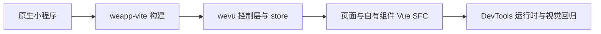
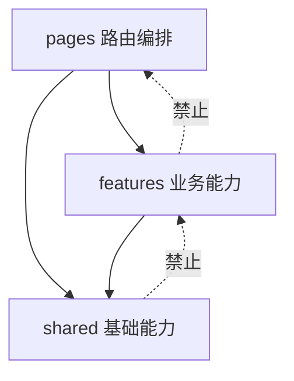

# CourseSched 工程架构与演进计划

## 1. 目标与约束

目标不是把原生小程序套进更多抽象，而是获得四个可验证收益：页面状态可推导、请求不会跨页面或跨账户污染、业务规则可单测、组件边界由复用和变化原因决定。

迁移路线已经推进到 Vue SFC：



现在位于阶段 D。应用入口、layout、三个路由页和项目自有组件均为 Vue SFC；TDesign Mini Program 作为经过验证的原生第三方组件保留。阶段 E 持续补齐真实 DevTools 交互和截图基线。

## 2. 精简目录方案

当前结构已经收敛为两级业务目录。业务域内默认平铺，Vue SFC 与对应服务、仓储和类型放在同一域目录；`pages/<route>` 与 `layouts/default` 保留 weapp-vite 约定层级。

```text
src/
├─ pages/
│  ├─ kb/
│  ├─ report/
│  └─ subCalendar/
├─ features/
│  ├─ auth/
│  │  ├─ account-coordinator.ts
│  │  ├─ account-store.ts
│  │  ├─ auth-repository.ts
│  │  ├─ auth-service.ts
│  │  ├─ auth-types.ts
│  │  └─ account-bind-dialog.vue
│  ├─ schedule/
│  │  ├─ schedule-store.ts
│  │  ├─ schedule-repository.ts
│  │  ├─ exam-repository.ts
│  │  ├─ types.ts
│  │  ├─ selectors.ts
│  │  ├─ course-grid.vue
│  │  └─ exam-schedule.vue
│  ├─ report/
│  │  ├─ report-store.ts
│  │  ├─ report-repository.ts
│  │  └─ report-types.ts
│  ├─ calendar/    # calendar-store.ts + repository/types
│  ├─ feedback/    # feedback-store.ts + service/repository/types
│  └─ notice/      # notice-store.ts + repository/types
└─ shared/
   ├─ api-client.ts
   ├─ request-scope.ts
   ├─ storage.ts
   ├─ app-error.ts
   ├─ dependencies.ts
   └─ app-navbar.vue
```

新增代码默认继续平铺。只有同类文件持续增长、存在两种以上实现、需要成组私有资源或形成独立发布边界时，才允许在单个业务域内局部分层；不要恢复全域统一的 `domain/data/application/components` 模板。

## 3. 依赖方向



- `pages` 可以组合多个 feature，但不实现缓存、解析、鉴权规则。
- feature 之间避免直接读取对方内部状态；跨域流程由页面或小型 application service 编排。
- `shared` 不能出现“课程、考试、账号绑定”等业务词汇。
- `shared/dependencies.ts` 是组合根，只负责实例装配，不承载业务判断。
- 页面只能通过领域 Store 访问业务数据；Repository 和 Service 不得直接导入页面。

业务数据保持单向流动：

```text
pages -> domain store -> repository/service -> API / Storage
```

## 4. 页面与状态

页面统一使用：

```vue
<script setup lang="ts">
definePageJson({ navigationStyle: 'custom' })

const loading = ref(false)
const rows = ref<Row[]>([])
const visibleRows = computed(() => rows.value.filter(item => item.visible))

onLoad(() => { /* 同步注册，异步工作放回调内 */ })
onUnload(() => { /* 取消请求和监听 */ })
</script>
```

约束：

- 原生请求任务、selector query、定时器和 `RequestScope` 留在闭包，不返回模板。
- 可由其他状态算出的值使用 `computed`，不再维护镜像变量。
- 一个弹层用一个判别联合 `overlay.type`，避免多个布尔值产生非法组合。
- 页面卸载或账户切换时取消请求；异步结果落地前再次比较账户键和页面存活状态。
- 业务数据、派生状态及对应的 Loading/Error 由小领域 Store 管理；页面只保留生命周期、导航、弹窗和表单交互等局部状态。
- `RequestScope`、原生请求任务等不可序列化对象不进入 Store，也不持久化。

## 5. Store 方案

只使用 wevu 自带 store：

```ts
import { computed, ref } from 'wevu'
import { defineStore, storeToRefs } from 'wevu/store'

export const useAccountStore = defineStore('account', () => {
  const accountKey = ref<string>()
  const isAuthenticated = computed(() => Boolean(accountKey.value))
  return { accountKey, isAuthenticated }
})

const accountStore = useAccountStore()
const { accountKey, isAuthenticated } = storeToRefs(accountStore)
```

action 可以直接从 store 获取；state/getter 必须通过 `storeToRefs` 解构。不要建立一个包含所有页面字段的全局 store。

Store 与持久化职责分离：Store 负责响应式业务状态和流程编排，Repository 负责 API、Storage、缓存校验、迁移和请求去重。Store 通过 `hydrate()` 从 Repository 恢复数据，不直接把整个响应式状态序列化。

| 持久化 | 不持久化 |
| --- | --- |
| 账户会话、课表快照、标签、考试缓存 | 报表数据、Loading、错误提示 |
| 日历订阅、日历提醒设置 | 弹窗状态、反馈草稿和截图 |
| 公告确认状态、反馈冷却时间 | `RequestScope`、请求任务等运行时对象 |

## 6. 有效组件化标准

组件化只有满足至少一项才有价值：被两个位置复用、拥有独立交互状态、隔离第三方组件细节、或可形成稳定的 props/events 契约。

不建议拆分：只包一层 `<view>`、只转发全部属性/事件、只在一个页面使用且没有独立变化原因的组件。此类拆分增加 JSON 注册、样式作用域和事件追踪成本，却没有降低维护成本。

当前组件边界：

| 组件 | 保留理由 |
| --- | --- |
| `app-navbar` | 多页复用并封装胶囊尺寸与导航事件 |
| `course-grid` | 独立排课布局、冲突和空课位事件 |
| `account-bind-dialog` | 多页复用且拥有完整表单契约 |
| `notice-dialog` / `feedback-dialog` | 独立交互流程和错误状态 |
| `bottom-actions` | 若长期只服务课表页且逻辑简单，可回收到页面 |

## 7. 请求与静默更新

推荐单向流程：

```text
读取缓存 -> 立即渲染 -> 判断 staleAt/retryAfter -> 后台条件请求
         -> updated: 替换快照
         -> not-modified: 只刷新时间和校验器
         -> offline: 保留缓存，不打断用户
         -> auth-required: 打开登录，不清空仍可用视图
```

已落地的保护包括：同账户请求去重、不同账户不共享进行中请求、清缓存代次保护、账户/学期隔离考试缓存、页面卸载取消和结果落地前身份复核。

后续建议给考试缓存增加 `fetchedAt/staleAt`，并把“手动刷新”和“静默刷新”策略参数化。静默失败仅记录诊断；手动失败才展示用户可操作反馈。

## 8. 迁移波次

| 波次 | 内容 | 验收 | 回滚点 |
| --- | --- | --- | --- |
| 1 | weapp-vite 构建、TDesign 补丁、CI | 原生页面生产构建通过 | 保留原项目 |
| 2 | wevu 页面控制层与账户 store | 三个路由无页面级 `setData` | 单页逐个回滚 |
| 3 | 并发、取消、派生状态修复 | 仓储并发测试和全量检查通过 | 仓储文件独立回滚 |
| 4 | 三个路由迁移 Vue SFC | `vue-tsc`、构建与生命周期通过 | 单页独立回滚 |
| 5 | 自有组件与应用入口迁移 SFC | 无原生注册、产物引用完整 | 单组件独立回滚 |
| 6 | DevTools 交互与视觉回归 | 页面截图、控制台与关键交互通过 | 保留迁移前截图基线 |

## 9. 剩余风险与优先级

| 优先级 | 风险 | 推荐方案 |
| --- | --- | --- |
| P0 | 传统账号密码必须持久化才能自动请求 | 后端换短期 access token + refresh token；迁移后删除 legacy password |
| P1 | 考试缓存无 TTL | 缓存 envelope 增加 `fetchedAt/staleAt`，静默刷新失败保留旧数据 |
| P1 | DevTools 自动化受服务端口和项目信任状态影响 | 固化课表、登录、报告、日历四条截图/交互验收路径 |
| P2 | 后续代码可能重新堆出无收益的分层目录 | 默认平铺；只有达到明确拆分条件时局部建目录 |
| P2 | TDesign Tabs 是定制补丁 | 升级依赖时执行补丁哈希、构建和视觉回归 |

## 10. 验证门禁

```powershell
pnpm exec wv prepare
pnpm validate:project
pnpm typecheck
pnpm lint
pnpm test
pnpm build
```

构建成功只证明编译契约成立。涉及布局、TDesign 插槽、导航或交互时，还必须在微信开发者工具中运行，并使用 `wv screenshot` / `wv compare` 保存运行时证据。
